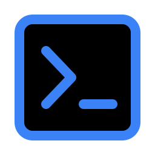

<h1> ShellAssist</h1>

An AI-powered desktop assistant to build, analyze, debug, simulate, and execute shell commands across Windows, macOS, and Linux.

## About The Project
Working in the terminal often means memorizing obscure flags, constantly searching for syntax, and nervously running complex scripts copied from the internet. ShellAssist was built to take the guesswork and risk out of the command line by giving you a safe, intelligent workspace to write, understand, and test shell commands before they ever touch your actual system.

## Key Features

* **Command Builder:** English-to-code generation and refinement.
* **Simulated Terminal:** Safe sandbox to test commands via AI simulation.
* **Interactive Terminal:** Live local shell execution & auto-debug loops.
* **Analyzer & Debugger:** Token inspector, risk assessment, and iterative error debugging.
* **Multi-AI Engine:** Bring your own API key (Gemini, ChatGPT, Claude) or run 100% privately via local Ollama.
* **5 Themes:** Dark, Light, Terminal Green, Terminal Red, and Monochrome.

## Live Demo
Run ShellAssist directly in your browser: [nitaidor.github.io/ShellAssist](https://nitaidor.github.io/ShellAssist/)

* **Supported in Web:** Command Builder, Code Analyzer, General Debugger, and Simulated Terminal.
* **Requires Desktop App:** Live terminal command execution on host and local offline Ollama models.

## Installation
### Option 1: Download Pre-Built Executables
Download the latest installer or portable executable directly from the [Releases page](https://github.com/nitaidor/ShellAssist/releases/latest).

### Option 2: Build from Source
Before you begin, ensure you have [Node.js](https://nodejs.org/) installed.

1. Clone the repository:
   ```bash
   git clone git@github.com:nitaidor/ShellAssist.git      # SSH
   git clone https://github.com/nitaidor/ShellAssist.git  # HTTPS
   ```
2. Navigate to the project directory:
   ```bash
   cd ShellAssist
   ```
3. Install dependencies and package the Windows desktop executables using the provided batch file:
   ```bash
   install.bat
   ```

## Usage (Development)

* Install dependencies:
   ```bash
   npm install
   ```
* Start the browser dev server (`http://localhost:5173`):
   ```bash
   npm run dev
   ```
* Build the production web bundle (`dist/`):
   ```bash
   npm run build
   ```
* Package desktop installers/executables (`dist-exe/`):
   ```bash
   npm run dist        # Windows
   npm run dist:linux  # Linux (AppImage & deb)
   npm run dist:mac    # macOS (dmg & zip)
   ```

## License
Distributed under the MIT License. See `LICENSE` for more information.

## Acknowledgments

* Desktop framework by [Electron](https://www.electronjs.org) (MIT License).
* Packaging tool by [electron-builder](https://github.com/electron-userland/electron-builder) (MIT License).
* Frontend library by [React](https://react.dev) (MIT License).
* Build tool by [Vite](https://vite.dev) (MIT License).
* UI framework by [Tailwind CSS](https://tailwindcss.com) (MIT License).
* Icons by [Lucide](https://lucide.dev) (ISC License).
* Local AI engine by [Ollama](https://ollama.com) (MIT License).